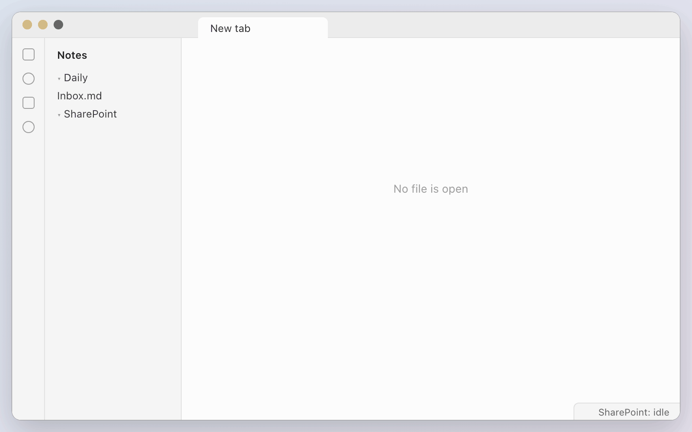
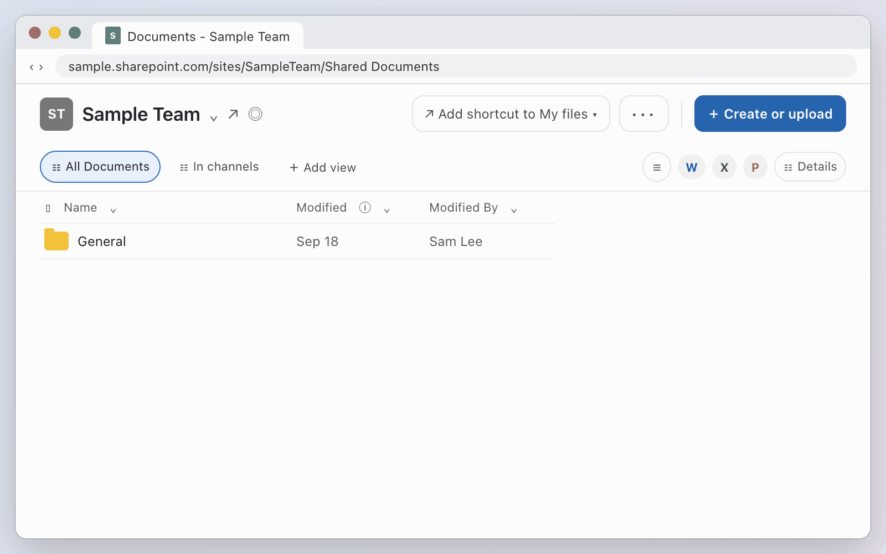
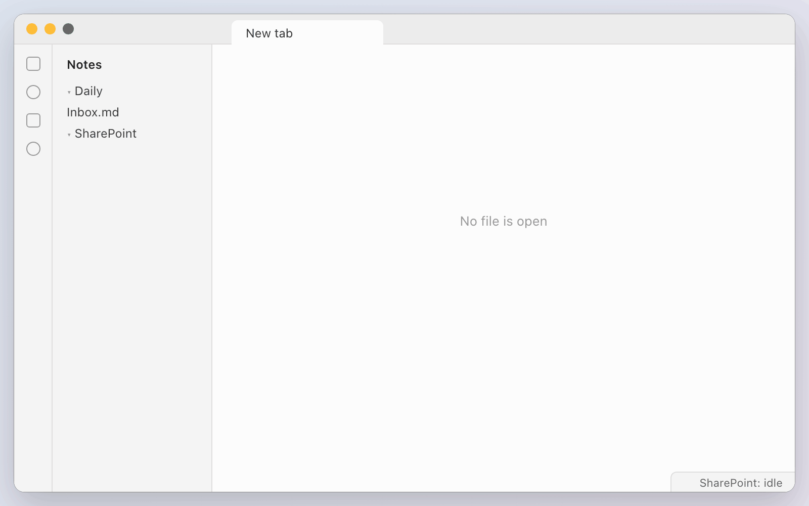
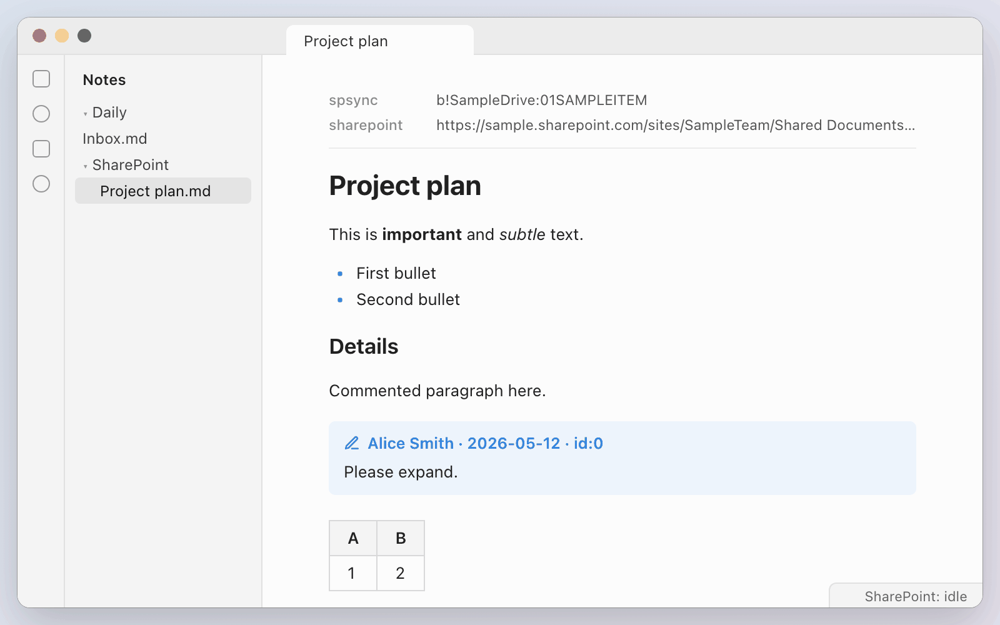
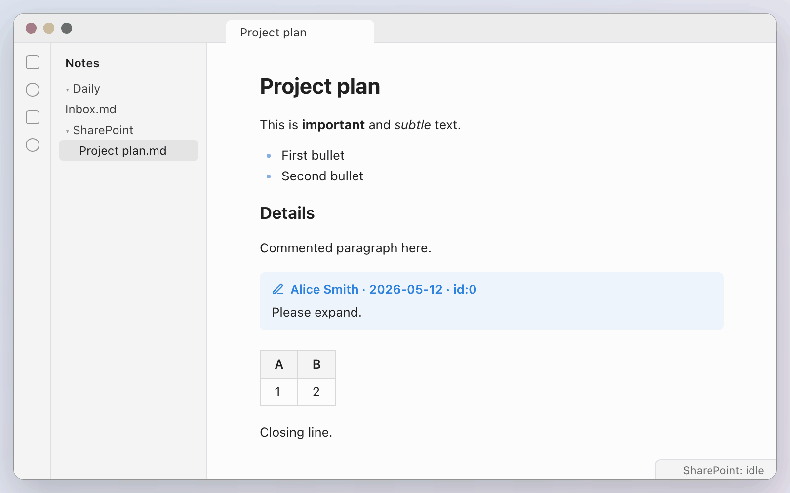
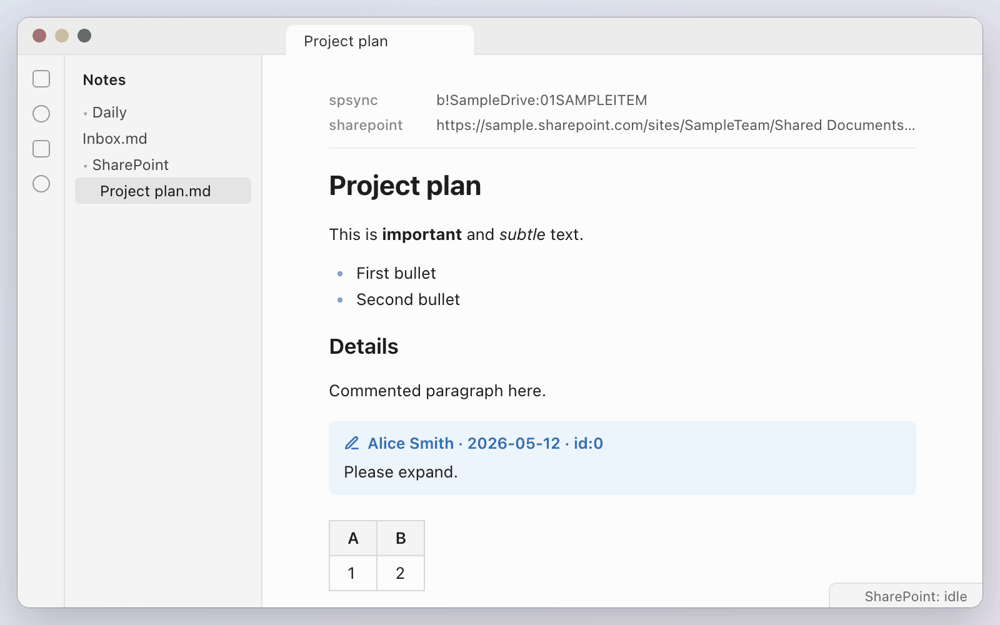
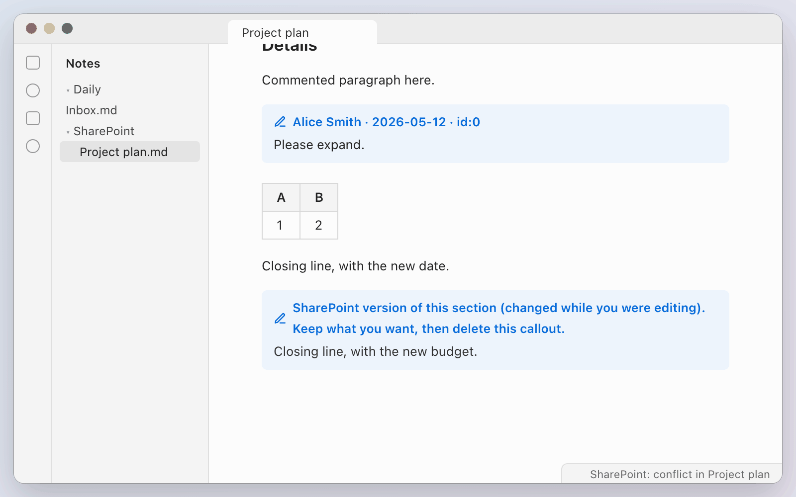
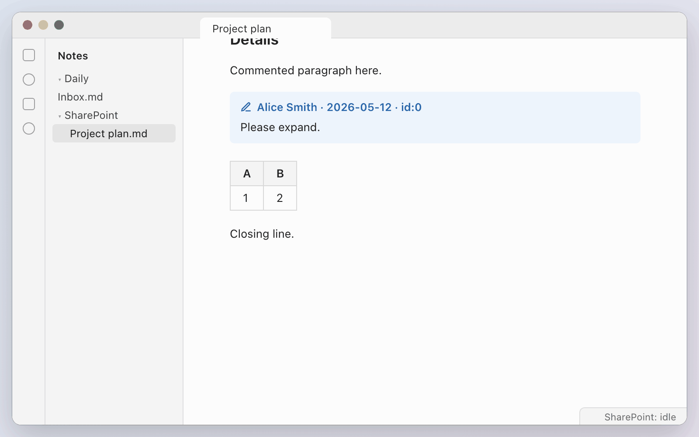
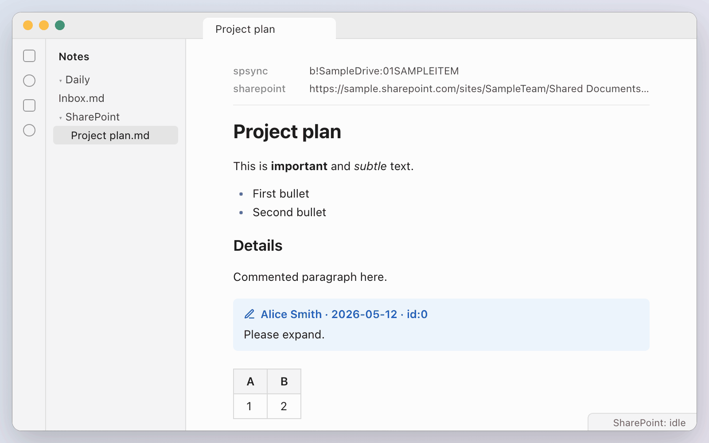

# spsync guide

This guide shows how to edit and comment on a SharePoint Word document as an Obsidian note. Each step has a short animation. The animations show a sample document and sample names.

You need a Mac with Apple silicon, Obsidian, Microsoft Word for Mac, and the OneDrive app. Sign in to Word and OneDrive with your work account. You do not need Terminal.

1. [Install the plugin](#1-install-the-plugin)
2. [Sync a SharePoint library with OneDrive](#2-sync-a-sharepoint-library-with-onedrive)
3. [Find and open a document](#3-find-and-open-a-document)
4. [Edit and sync a note](#4-edit-and-sync-a-note)
5. [Add, reply to, and resolve comments](#5-add-reply-to-and-resolve-comments)
6. [Send edits as tracked changes](#6-send-edits-as-tracked-changes)
7. [Resolve a conflict](#7-resolve-a-conflict)
8. [Locked content and private notes](#8-locked-content-and-private-notes)
9. [Fix setup problems](#9-fix-setup-problems)

## 1. Install the plugin

The **BRAT** plugin installs **SharePoint Sync** from GitHub and installs its updates.

1. In Obsidian, open Settings > **Community plugins**. If Obsidian asks, turn on community plugins.
2. Click **Browse**, and search for `BRAT`. Click **Install**, then click **Enable**.
3. Close Settings. Press <kbd>Cmd</kbd>+<kbd>P</kbd> to open the command palette, and run **BRAT: Add a beta plugin for testing**.
4. Enter `jekozyra/spsync`, and click **Add plugin**. BRAT installs and enables SharePoint Sync.
5. Wait for the "Downloading the spsync CLI" notice to close. The plugin downloads the spsync command-line tool one time for each plugin version.

<picture>
  <source media="(prefers-reduced-motion: reduce)" srcset="images/01-install.png">
  
</picture>

## 2. Sync a SharePoint library with OneDrive

spsync reads and saves documents through the OneDrive folder on your Mac. Add each SharePoint library that you use to OneDrive one time.

1. Open the SharePoint library in your browser.
2. Click **Add shortcut to My files** or **Sync**. Both buttons add the library to the OneDrive app.
3. In Finder, open the OneDrive location. The library folder is in the list, and its documents are in the folder.

If the OneDrive app is not signed in, sign in with your work account first.

<picture>
  <source media="(prefers-reduced-motion: reduce)" srcset="images/02-onedrive.png">
  
</picture>

## 3. Find and open a document

1. Press <kbd>Cmd</kbd>+<kbd>P</kbd>, and run **SharePoint Sync: Find and open a SharePoint document**.
2. Type words from the document name, and press <kbd>Return</kbd>.
3. Pick the document. spsync makes a note for the document in the `SharePoint` folder of your vault, and opens the note.

To open a document from a link, run **Open a SharePoint link**. To see the documents that you opened recently, run **Open a recent SharePoint document**.

<picture>
  <source media="(prefers-reduced-motion: reduce)" srcset="images/03-find-and-open.png">
  
</picture>

## 4. Edit and sync a note

1. Edit the text in the note.
2. Run **Sync this note**, or click the sync icon in the left ribbon.
3. A notice shows the result, for example `pushed. 1 edited`. The status bar shows the time of the last sync.

spsync changes only the paragraphs that you edited in the Word document. Paragraphs that you did not edit stay the same, and so does the formatting of other people.

By default, the plugin also syncs automatically. It sends your edits 30 seconds after you stop typing, and it gets changes from SharePoint every 5 minutes. To change these times, or to turn off automatic sync, open the SharePoint Sync settings.

<picture>
  <source media="(prefers-reduced-motion: reduce)" srcset="images/04-edit-and-sync.png">
  
</picture>

## 5. Add, reply to, and resolve comments

Comments from Word show as callouts under their paragraph:

```markdown
> [!comment] Alice Smith · 2026-05-12 · id:0
> Please expand.
```

- **Add a comment:** put the cursor in a paragraph, and run **Comment on this paragraph**. Type your comment after `> [!comment] `.
- **Reply to a comment:** put the cursor in the comment, and run **Reply to this comment**. Type your reply on the `> ` line under `> [!reply] re:0`. The number after `re:` is the `id` of the comment.
- **Resolve a comment:** add ` · resolved` to the end of the comment header.

Then sync the note. The notice shows the number of new comments, replies, and resolved comments.

When spsync uses Word for Mac to save the document, Word cannot make threads or resolve comments. spsync then adds each reply as a new comment that starts with "Re <name>:". Resolve the comment in Word.

<picture>
  <source media="(prefers-reduced-motion: reduce)" srcset="images/05-comments.png">
  
</picture>

## 6. Send edits as tracked changes

Use tracked changes for documents that other people own. The owner accepts or rejects each change in Word.

1. Edit the note.
2. Run **Send edits as tracked changes**.
3. Open the document in Word. On the **Review** tab, your edits show as tracked changes.

To send all edits as tracked changes, turn on **Send edits as tracked changes** in the SharePoint Sync settings. Automatic sync then also sends tracked changes.

<picture>
  <source media="(prefers-reduced-motion: reduce)" srcset="images/06-tracked-changes.png">
  
</picture>

## 7. Resolve a conflict

A conflict occurs when you and another person change the same paragraph before a sync. spsync keeps your text and adds a `[!conflict]` callout under it. The callout shows the SharePoint version of the paragraph.

1. Edit your paragraph so that it has the text that you want to keep.
2. Delete the full callout, from the `> [!conflict]` line to the last `>` line.
3. Sync the note again.

spsync does not send a note that has a `[!conflict]` callout.

<picture>
  <source media="(prefers-reduced-motion: reduce)" srcset="images/07-conflict.png">
  
</picture>

## 8. Locked content and private notes

spsync shows some content that it cannot change safely. This content is locked:

- Tables, images, fields, content controls, and footnotes
- Paragraphs with tracked changes that are not accepted yet. The note shows inserted text as `==inserted==` and deleted text as `~~deleted~~`.

If you edit locked content, spsync does not send the edit. The sync notice shows a warning such as `Skipped edit to a block Obsidian can't safely change (table)`. Make changes to locked content in Word.

Text between `%%` and `%%` is private. spsync never sends private text to SharePoint, so you can keep your own notes in the document note.

<picture>
  <source media="(prefers-reduced-motion: reduce)" srcset="images/08-locked-and-private.png">
  
</picture>

## 9. Fix setup problems

Run **Check setup** when a command fails, or after you install the plugin.

1. Run **SharePoint Sync: Check setup**. Word can start in the background during the check.
2. Read the list. Each check shows **Pass** or **Fail**. A failed check shows one fix.
3. Do the fix, and run **Check setup** again.

The first check can show a macOS prompt that asks if Obsidian can control Microsoft Word. Click **Allow**. If you did not allow it, open System Settings > Privacy & Security > Automation, and turn on **Microsoft Word** under **Obsidian**.

<picture>
  <source media="(prefers-reduced-motion: reduce)" srcset="images/09-check-setup.png">
  
</picture>
